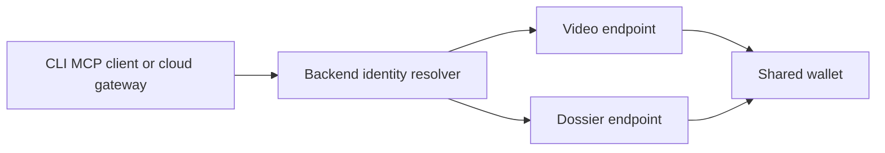

# Service identity and shared payment wallets

A service is identified by its registered endpoint, service ID, or directory
slug. Payment destinations are associations with that service, not globally
unique product identifiers. Multiple endpoints can share a payee and retain
independent reviews, scores, and service IDs.

When an endpoint is supplied, payment-target lookup cannot select a different
service. A new endpoint remains unresolved until its first signed, verified
review registers it. Existing service identities still reject unregistered
endpoint aliases and payment destinations. Wallet-only lookup succeeds only
when exactly one service matches; otherwise the caller must supply the endpoint
or service ID. Machine-payment aliases remain case-insensitive and can span
x402 (Base or Monad) and mppx/Tempo for the same registered EVM payee. A
service may also hold one x402 Solana payee (base58, matched exactly); the
first verified Solana payment registers it as a `payment_target` identifier
(docs/SCORING.md §3.4 rule 8).

## Services whose payee rotates

Some providers issue a single-use payment destination with every 402. Parallel
MPP Search answers each call with a new 0x address, on Base and on Tempo. The
payee cannot anchor such a service's identity: there is nothing stable to store,
and pinning the first one seen refuses every later purchase as
`service identity conflict` — which is exactly what happened to it, costing two
reviews of a genuine paid call on 2026-10-27.

`services.payee_rotates` marks these. Resolution then authorizes any payee of a
machine-payment address family for that service, no payee is stored, and a
verified payment registers no alias (one row per sale, forever, would be the
alternative). Identity rests on the endpoint — a globally unique product
identifier that payment-target lookup can never override — and on the gateway
receipt: a judged hosted review is pinned to the payee and endpoint the *ledger*
recorded, not to what the agent claimed (docs/SCORING.md §3.6), and the on-chain
check still proves the transfer reached the payee the review names.

What that costs, stated plainly: for these services alone CrowdCode cannot tell
a payee the provider has just issued from one the caller made up — both are
addresses it has never seen, which is what "rotates" means. A community review
could name a payee it really paid that was never this provider's. The endpoint
still decides which service a review lands on, so a payee can never redirect
one onto a different listing, and a community review carries weight exactly
zero; everything that moves a ranking is a hosted receipt, where the gateway
and not the agent states the payee. The alternative was a service nobody could
review at all.

Only an operator sets the column, with `scripts/fix_machine_payees.py`, which
requires two probes of the service's own 402 to advertise different payees
before it will.

Registration takes a transaction advisory lock and re-resolves the endpoint to
avoid duplicate services during concurrent first reviews. A transfer proves
payment to the wallet; it does not independently attest which URL was served.
The review signature binds the asserted URL to the reviewer, as before.

## Rollout

1. Deploy backend 0.5.2 or newer. Its inserts work under either schema, and
   wallet lookups include canonical service payees to cover old omitted aliases.
2. Apply `supabase/shared-payment-wallets.sql` in one transaction. Product
   identifiers stay globally unique; payment destinations become unique per
   service. Canonical payment associations are backfilled idempotently. No
   service IDs, reviews, or scores are merged or deleted.
3. Verify an existing endpoint still resolves, two endpoints can share one
   payee, and a wallet-only lookup of that shared payee reports ambiguity.
4. Retry pending reviews using their original settled receipts. Do not purchase
   the service again just to retry its review.

Do not roll back to a backend older than 0.5.2 after applying the schema change:
older code assumes one globally unique payment identifier and uses its old
conflict target. Roll forward with a compatible backend if needed.

## Verification

`TEST_DATABASE_URL=postgresql://... python -m pytest -q` includes real PostgreSQL
schema/backfill, concurrent-registration, and signed-review regressions. Tests
create and remove isolated schemas; they never use `DATABASE_URL` as the test
connection. CI runs these against its dedicated PostgreSQL service.
