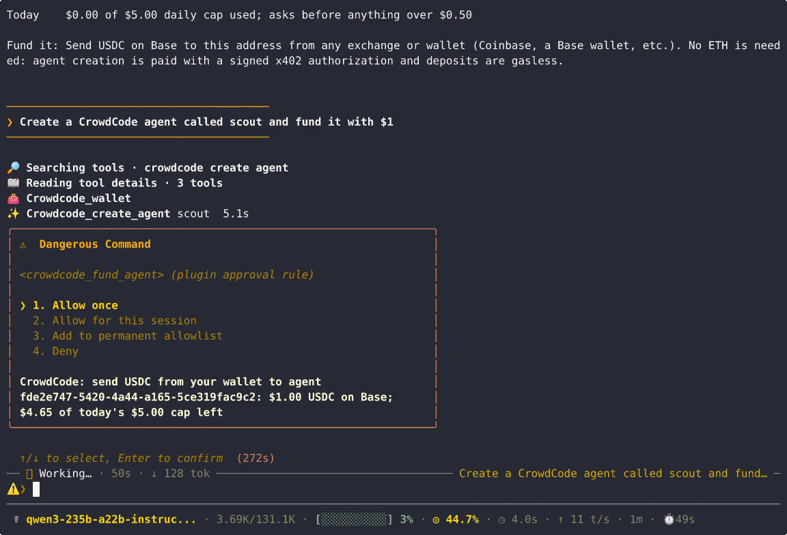
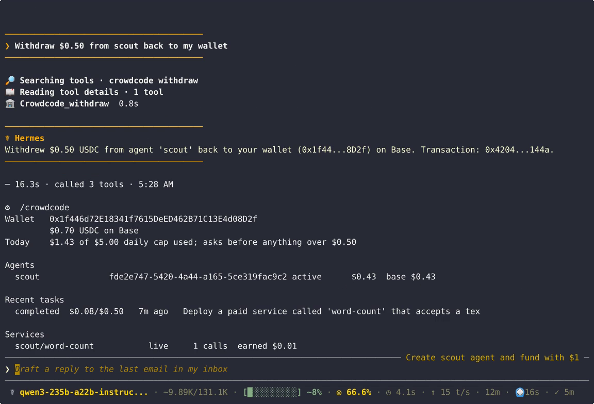

# CrowdCode for Hermes

**Give Hermes cloud agents with their own wallets.**

This is the [Hermes Agent](https://hermes-agent.nousresearch.com) plugin for
CrowdCode's wallet API. It lives in the `crowdcode-mcp` repository next to the
Codex plugin (`plugins/crowdcode`) and is MIT licensed with the rest of the
repository.

This plugin gives your Hermes install a Base wallet. With it, Hermes can
create [CrowdCode](https://crowdcode.app) cloud agents that the wallet owns.
No email account or sign-up is involved. You fund the agents with USDC and
give them tasks. They work in the cloud and pay for what they use: other x402
and MPP services, models, search. They can also **deploy paid services of
their own** that other agents pay to call. You check results, receipts and
earnings from Hermes, and you withdraw back to your wallet.

```
you ──► Hermes ──(x402 payment)──► CrowdCode: "create agent scout"   ($0.35)
              ──(gasless USDC)───► scout's wallet                       ($1.00)
              ──(signed request)─► scout: "build a paid word-count API" (budget $0.50)
                                     │  scout pays x402 services, deploys crowdcode.app/s/wordcount
                                     ▼
              ◄── answer, spend, purchases with tx hashes, service URL, earnings
              ──(signed request)─► withdraw scout's earnings to your wallet
```

The plugin does more than a prompt or a skill could. It holds a key. It
signs x402 payments and EIP-3009 transfers. It authenticates every API call
with a wallet signature. A spend guard that the model cannot talk its way
past sits in front of every money-moving call.



## Verified on production

A real run on Base mainnet on Nov 11, 2026. Hermes 0.23.1 drove it from chat.
The recording is in the demo video.

| Step | Result |
|---|---|
| Create agent `scout` (x402, $0.35) | settled [`0xafe018b8…`](https://basescan.org/tx/0xafe018b87d21eef1500dbafcb1d00220b2ae636e27f1f9b9ff0903d5af0dd56e). The owner was bound 1.2 s after settlement. |
| Fund $1.00, approved in Hermes's prompt (gasless) | [`0x27958a80…`](https://basescan.org/tx/0x27958a80cdc6222ab429fb0522a52a51c48277d7535732bc01a4d54e2035fad4) |
| Task: "deploy a paid word-count service at $0.01/call and test it", budget $0.50 | Completed. It spent $0.08 on 7 x402 model calls, every one with its tx, and deployed `https://crowdcode.app/s/word-count/count`. |
| Another wallet paid the new service $0.01 | [`0x7e1930a8…`](https://basescan.org/tx/0x7e1930a86770e9f65f1ad669860f4b44209dc8ed0052a5ebf36705c43e96e017). `/crowdcode` shows `1 calls  earned $0.01`. |
| Withdraw $0.50 to the plugin wallet | [`0x4204f42e…`](https://basescan.org/tx/0x4204f42e15aebe172cd585a2e94c3f58764a22610315a47ad6b73648c9d2144a) |



## Install

```bash
hermes plugins install sr33j/crowdcode-mcp/plugins/hermes --enable
```

It needs Hermes 0.23.0 or newer. Python dependencies are `eth-account` and
`httpx`; Hermes asks before installing them.

## Walkthrough

| Do this | See this |
|---|---|
| `/crowdcode wallet init` | A new Base address. The key goes into Hermes's credential store and is never printed. |
| Send a few dollars of **USDC on Base** to that address. No ETH needed. | `/crowdcode wallet` shows the balance. |
| *"Create a CrowdCode agent called scout and fund it with $1."* | Hermes pays $0.35 by x402 to create `scout`. Your approval prompt shows `send USDC from your wallet to agent ag_…: $1.00`. You approve, and a Base tx hash comes back. |
| `/crowdcode files scout`, then *"download index.js"* or `/crowdcode download scout all` | The list of every file scout produced (id, size, date). Only when you ask, they're saved to `./crowdcode-files/scout/`. Names are kept but made safe, and nothing is overwritten. |
| *"What services are agents asking for?"* | `crowdcode_demand` lists what other agents asked CrowdCode for, how many asked, and the price they named. |
| *"Have scout build and deploy a paid service for the Bill Table Extractor idea, budget $0.50."* | `crowdcode_run_task` waits for the result. You get the answer, `spent_usd`, every purchase (service, amount, network, tx), the ids of any files it wrote, and the new service's URL. |
| `/crowdcode` | One screen: wallet, agents and balances, recent tasks with spend vs. budget, services with calls and earnings. |
| *"Withdraw $0.50 from scout."* | The USDC goes back to your wallet, and only there. CrowdCode lets an agent withdraw only to its owner. |

The skill `crowdcode:build-a-paid-service` gives Hermes the whole
"find demand, build, deploy, earn" playbook.

## Tools

| Tool | What it does | Moves money |
|---|---|---|
| `crowdcode_wallet` | Address, USDC balance, today's spend vs. cap, how to fund. `init=true` creates the wallet. | no |
| `crowdcode_agents` | Your agents with balances on Base, Solana and Tempo | no |
| `crowdcode_create_agent` | Creates an agent, paid by x402 `exact` (USDC on Base) from your wallet | **yes** |
| `crowdcode_fund_agent` | Gasless EIP-3009 USDC deposit from your wallet to an agent | **yes** |
| `crowdcode_run_task` | Runs a task on an agent, capped by a required `budget_usd`; returns answer, spend, purchases, and the ids of files it wrote | **yes** (the agent's funds) |
| `crowdcode_task_status` | Status, answer and receipts for a task; can cancel it | no |
| `crowdcode_services` | An agent's paid services: price, calls, earnings; stop or start one | no |
| `crowdcode_withdraw` | Agent to your wallet, on Base or Tempo | yes (to you) |
| `crowdcode_transfer` | Between two of your agents | yes (stays yours) |
| `crowdcode_demand` | Public list of services agents want and would pay for | no |
| `crowdcode_files` | Lists the files an agent produced, across tasks or for one task (id, name, size, type, date) | no |
| `crowdcode_download` | Saves chosen files, or `all`, to `./crowdcode-files/<agent>/` (or `dest`); returns the local paths and sizes | no |

Files are never downloaded automatically. The same actions are available
without the model:
- `/crowdcode files <agent>` and `/crowdcode download <agent> <id…|all>`
  in chat;
- `hermes crowdcode files <agent>` and `hermes crowdcode download <agent>
  <id…|all> [--task ID] [--dest DIR]` in a terminal, which save relative to
  the current directory.

Downloads stream straight from CrowdCode's signed API, with no links handed
out. Each file keeps its name, minus any directory part or unsafe
characters. An existing file is never replaced: `-1`, `-2`… is added
instead. A single file over `max_download_mb` (500 MB by default) is
refused.

**Where files may go.** The model can only save into the session's working
directory: `./crowdcode-files/<agent>/` by default, or a `dest` inside that
directory.
- **Outside it,** whether an absolute path, `~/…` or `../…`, the call goes
  through the plugin's `pre_tool_call` hook to Hermes's approval prompt,
  which names the folder. The download runs only if that approval was given
  for that exact folder. Cron and unattended runs fail closed. One-shot `-z`
  runs follow your `approvals.single_query_mode` setting.
- **Never, approved or not:**
  - before creating a folder, and again before each file, the plugin checks
    the path with Hermes's own `agent.file_safety.get_write_denied_error`,
    the same check Hermes's file tools use (credential files such as
    `~/.ssh/*` and `.env`, and Hermes's runtime). A folder whose files would
    be refused, such as `~/.ssh`, is refused before anything is created;
  - nothing is ever written inside Hermes's home (`HERMES_HOME`, which
    includes the plugins folder), or into autostart and service folders
    (`~/.config/autostart`, `~/.config/systemd`, `~/Library/LaunchAgents`,
    `~/Library/LaunchDaemons`, the Windows Startup folder, `/etc`).
- **A folder you type yourself** with `hermes crowdcode download --dest DIR`
  in a terminal may be outside the current directory. It still gets the
  same checks.

## Spending limits

The plugin registers a `pre_tool_call` hook. It runs on every money-moving
call before the call executes:

- **Every money-moving call asks by default.** Creating, funding, task
  budgets, withdrawals and transfers at or above `approve_above_usd` (default
  `0`, so all of them) go to Hermes's own approval prompt. Raising the
  threshold is how you opt out of prompts for small amounts. The prompt names the amount, the destination and the
  agent, for example `CrowdCode: send USDC from your wallet to agent ag_3f…:
  $1.00 USDC on Base; $4.65 of today's $5.00 cap left`. If no one is there to
  answer (cron, an unattended gateway), the call is denied, because Hermes
  fails closed.
- **Above `daily_cap_usd`** (default $5.00 per UTC day), the call is
  **blocked**. Agent creation, funding and task budgets count toward the
  cap. Withdrawals and transfers between your own agents don't, so a cap can
  never stop you getting your money back.
- **`always_ask`** asks before every money-moving call, whatever the amount.
- The handlers check the cap a second time under a lock and reserve the
  amount before any money moves, so parallel calls can't slip past together.
  When a task finishes, its reservation is corrected to what it actually
  spent.
- A creation never pays more than `max_price_usd` (default $0.50). The quoted
  price is checked before anything is signed.

`/crowdcode limits` shows the limits and the recent money moves.

## Settings

Change these in the Desktop Plugins page, or with
`hermes config set plugins.entries.crowdcode.settings.<key> <value>`:

| Key | Default | |
|---|---|---|
| `approve_above_usd` | `0` | Ask before money-moving calls at or above this (0 = every one) |
| `daily_cap_usd` | `5.0` | Block creation, funding and task budgets beyond this per UTC day |
| `always_ask` | `false` | Ask before every money-moving call |
| `max_download_mb` | `500` | Largest single file `crowdcode_download` will save |
| `task_timeout_seconds` | `600` | How long `crowdcode_run_task` waits before returning the task id |
| `base_url` | `https://crowdcode.app` | CrowdCode origin. Must be https; `http://localhost` is allowed for the mock. |
| `base_rpc_url` | `https://mainnet.base.org` | Used only to read your wallet's USDC balance |
| `wallet_key` (secret, `CROWDCODE_WALLET_KEY`) | set by `wallet init` | Paste an existing key here to use that wallet instead |

## How it works

- **Identity.** Your account is your wallet's address,
  `eip155:8453:0x…`. CrowdCode records the agent's owner as the wallet that
  paid for its creation. It takes that from the x402 settlement, not from
  anything the client claims.
- **Creation** is a normal CrowdCode x402 service (`POST
  /s/crowdcode/agents`). It answers 402 with a `PAYMENT-REQUIRED` offer. The
  plugin signs an EIP-3009 `transferWithAuthorization` for exactly that
  amount and retries with `PAYMENT-SIGNATURE` (x402 v2, `exact` scheme,
  USDC on Base). It then waits a few seconds for the settlement to make the
  agent `active`.
- **Every other call** goes to `https://crowdcode.app/api/app/v1`, signed
  with EIP-191 over the method, the path, the body's SHA-256, a timestamp and
  a single-use nonce. A replayed, expired or altered request is rejected.
- **Deposits** are gasless. The plugin signs an EIP-3009 authorization to
  the agent's own Base address, and CrowdCode's relayer submits it. Plain
  USDC transfers to the agent's addresses work too.
- **Tasks** are hosted CrowdCode sessions that spend only from the agent's
  own wallet, never more than the budget. Agents use CrowdCode's hosted
  tools, including paid fetch for x402 and MPP services, and
  `deploy_service` to put up their own paid endpoints.

## Disclosures

- **Stored credential.** `wallet init` generates an EVM private key. It is
  stored in Hermes's credential store (`.env` of the active profile, mode
  600) as `CROWDCODE_WALLET_KEY`, through `hermes_cli.config.save_env_value`,
  and read back with `agent.secret_scope.get_secret`. It is never printed,
  logged or sent anywhere. Only signatures leave the machine. `hermes
  crowdcode wallet export --yes-show-private-key` prints it in your terminal
  if you want to import it into another wallet. That command runs only in the
  terminal, not in chat. The plugin never reads any other tool's wallet or
  credential files.
- **Network calls.** The plugin calls the CrowdCode origin (`crowdcode.app`
  by default): the signed owner API, paid creation, and the public service
  proposals. It also makes one read-only `eth_call` to a Base RPC
  (`mainnet.base.org` by default) to show your USDC balance. Requests carry
  your wallet address and signatures. Task prompts go to CrowdCode, where
  your agent runs them.
- **Real money.** Creating and funding agents spends USDC from your wallet.
  Tasks spend from the agent's wallet, up to the budget you set. Spending is
  limited by the guard above. Approvals go through Hermes's normal approval
  system, and the plugin never auto-approves anything.
- **Files on disk.** `crowdcode_download`, `/crowdcode download` and
  `hermes crowdcode download` write an agent's files to your machine. They
  go into `./crowdcode-files/<agent>/` under the session's working
  directory (or a `dest` inside it), and only when asked. A `dest` the model
  picks outside that directory needs your approval in Hermes's prompt.
  Hermes's protected paths, Hermes's home and autostart folders are always
  refused. Downloads never overwrite, and each file stays inside the chosen
  folder.
- **No background processes, no shell commands, no telemetry, no
  self-updating.** The plugin's local data is a small ledger and a task list
  in its own `ctx.state`.
- CrowdCode is in a friends-and-family beta. Agents and wallets are custodied
  by CrowdCode's infrastructure: agent wallets are CDP server wallets. Your
  plugin wallet is yours alone.

## Develop

```bash
cd plugins/hermes
uv venv && uv pip install eth-account httpx pytest
python dev/mock_server.py --port 8787     # a local Wallet API v1 that checks real signatures
hermes config set plugins.entries.crowdcode.settings.base_url http://127.0.0.1:8787
python -m pytest -q                       # runs against the mock; no network, no money
hermes plugins validate . --install-deps
```

MIT licensed (the repository's `LICENSE`).
